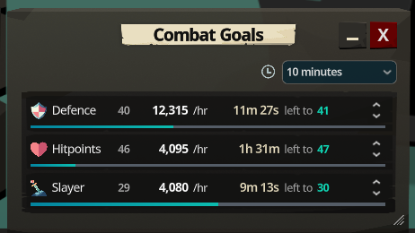

<h1 align="center"></h1>

<p align="center">
  <a href="../../README.md"></a>
  &nbsp;
  <a href="https://github.com/Springs-Tea/melvor-idle-2-qol-mods/releases"></a>
  &nbsp;
  <a href="https://www.nexusmods.com/melvoridle2/mods/20"></a>
</p>

> How long until Magic 20, while I am also training Hitpoints and Defence?



The game's footer tells you how long a skill needs to reach a level you type in, but only for the one skill
you are doing. Combat trains several at once. Combat Goals is that footer line for every combat skill that
is gaining XP: its rate, a goal of your own, and the time left.

## Contents

- [Opening it](#opening-it)
- [Reading a line](#reading-a-line)
- [Setting a goal](#setting-a-goal)
- [What the rate is measured over](#what-the-rate-is-measured-over)
- [Moving and resizing](#moving-and-resizing)
- [Good to know](#good-to-know)
- [When something is off](#when-something-is-off)

## Opening it

Start a fight. The window appears by itself in the bottom right corner, and a round button with the combat
icon appears in the strip of round buttons on the right edge of the screen. That button, or **F10**, hides
the window and shows it again. Outside combat the window and the button are not there.

For the first ten seconds of a fight the window says "Waiting for combat XP...": a rate needs a little
history.

## Reading a line

```
[icon] Hitpoints  28      1,271 /hr              1m 56s  left to [ 29 ]
[=============----------------------------------------------------]
```

| Part | What it is |
| --- | --- |
| **Hitpoints 28** | The skill and your level in it. |
| **1,271 /hr** | XP per hour in this skill, in this fight, over the time period chosen at the top. |
| **1m 56s left to [ 29 ]** | The time until the level in the box at that rate. "now" when you are there; "years" when it is that far. |
| The bar | How far you are from your current level's start to the goal. |

Only skills that are **gaining XP right now** are listed, so a melee fight shows three or four lines and
not eight. A skill at its level cap is left out.

## Setting a goal

Type a level into the box at the end of a line, or use its arrows. Until you do, the goal is simply the
next level. A goal you set is remembered for that character; when you reach it, the box moves on to the
next level by itself.

## What the rate is measured over

The box at the top of the window chooses how much recent play the rate is averaged over: 1, 5, 10 or 30
minutes. A short period follows changes quickly but jumps around, because XP arrives hit by hit. A long one
is steady but slow to notice that you changed something. Ten minutes is the default.

The rate is always that of **the fight you are in**:

- Leaving combat, or starting to fight another enemy, starts the measurement again. Time spent fishing never
  drags your combat rate down.
- A dungeon counts as one fight from its first enemy to its last.
- After the game was paused or closed, the measurement starts again too: XP gained offline did not arrive at
  a rate anyone could measure.

## Moving and resizing

| | |
| --- | --- |
| Move | Drag the window from any empty spot. |
| Resize | Drag its bottom right corner, from 70% to 200%. Text and icons are redrawn sharp at the new size. |
| Hide | The eye in its top right corner, the round button, or F10. |

The place, the size, the period and whether it is hidden are remembered.

## Good to know

- The time left assumes the rate stays what it is. A level up that makes you hit harder shortens it.
- The eight skills it knows are Attack, Strength, Defence, Hitpoints, Ranged, Magic, Prayer and Slayer.
- Everything it remembers is in `mods\CombatGoals\settings.json`. A file that cannot be read is set aside
  as `settings.json.broken` and the defaults are used.

## When something is off

| You see | What it means |
| --- | --- |
| "Waiting for combat XP..." that does not go away | No combat skill has gained XP in the last period: you are not hitting, or every skill being trained is at its cap. |
| No window in combat | It is hidden: press F10 or the round button. |
| No round button | The log says "The game's widget strip was not found": a game update moved it. F10 still works. |
| Nothing at all | Look for `[CombatGoals] Stopped` in `MelvorModLoader.log`: the mod switched itself off after a game update. |

## Install

<p>Get the zip from <a href="https://github.com/Springs-Tea/melvor-idle-2-qol-mods/releases">Releases</a>, or from <a href="https://www.nexusmods.com/melvoridle2/mods/20">the mod's page on Nexus Mods</a> if you prefer.</p>

1. Install the [Melvor Mod Loader](https://www.nexusmods.com/melvoridle2/mods/2) (0.1.3 or newer).
2. Open the game folder: Steam > right-click Melvor Idle 2 > Manage > Browse local files.
3. Extract the mod's zip there, so the file ends up as `mods\CombatGoals\CombatGoals.dll`.
4. Start the game. `MelvorModLoader.log` in the game folder has a line `Mod loaded: CombatGoals`.

To update, extract the new zip over the old one. To remove the mod, delete `mods\CombatGoals`. Your goals and the window's place are in `settings.json` there.
Your save is never changed.
