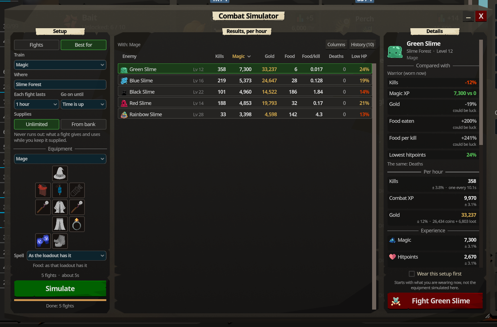
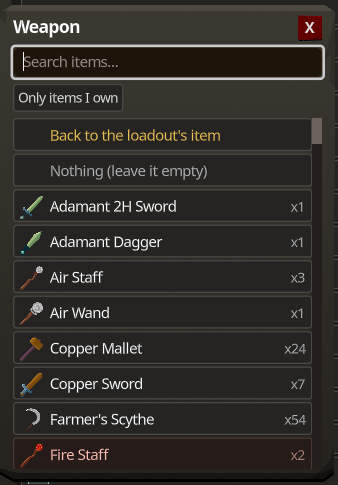
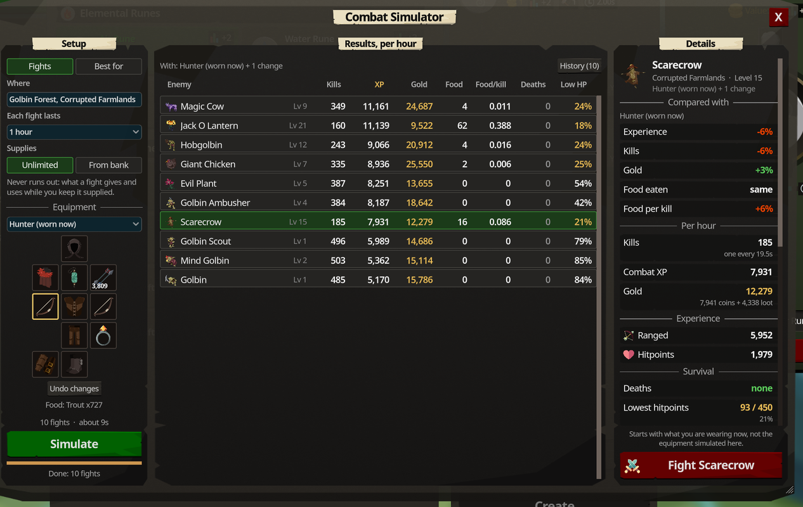
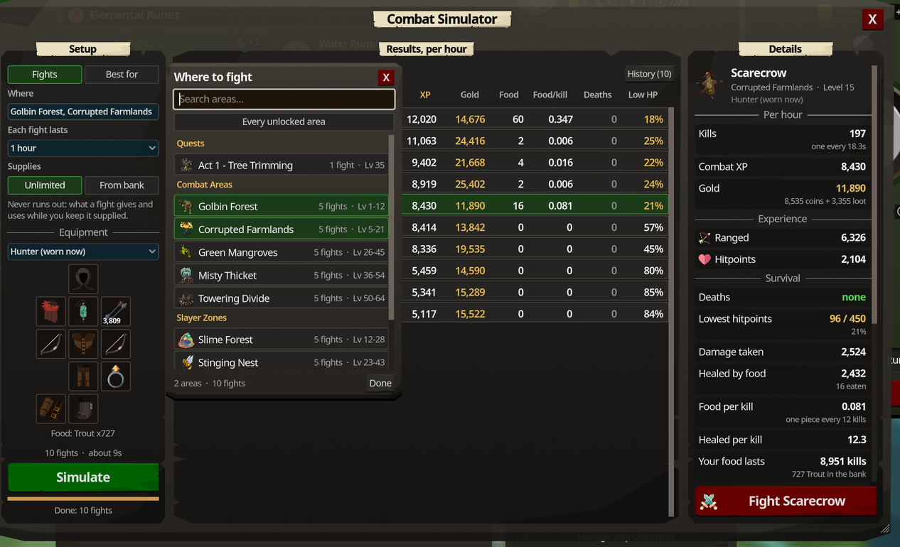
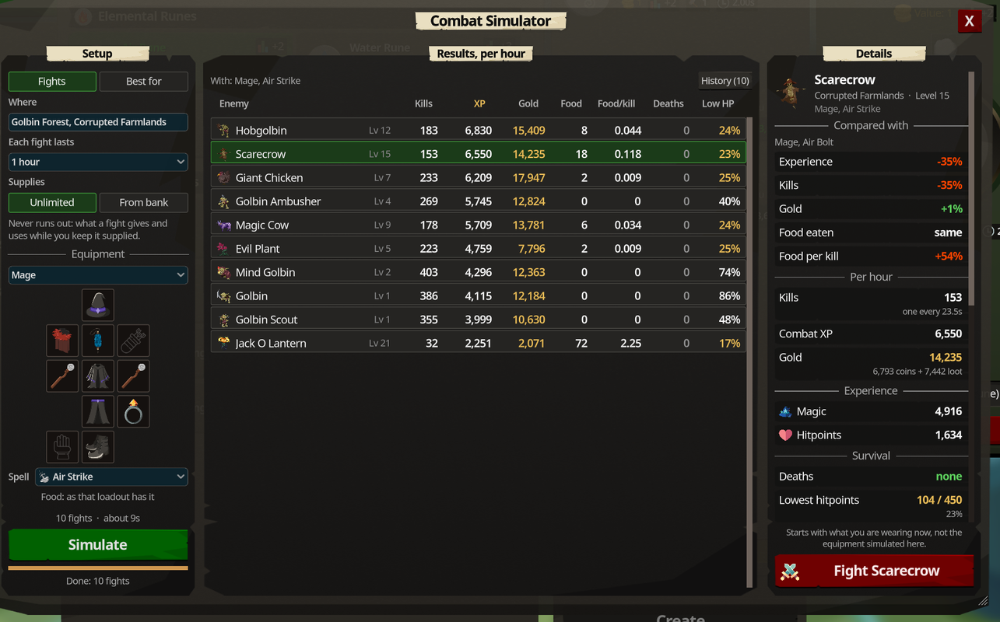
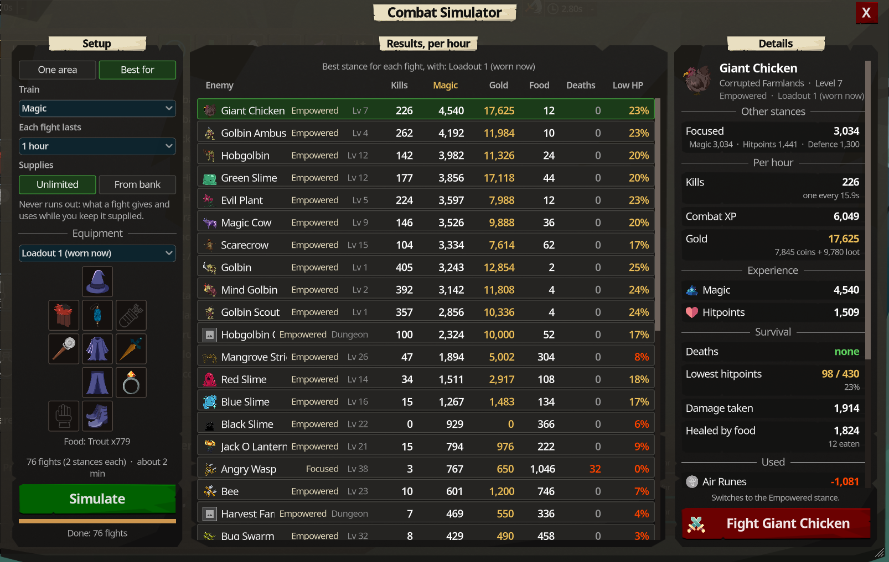
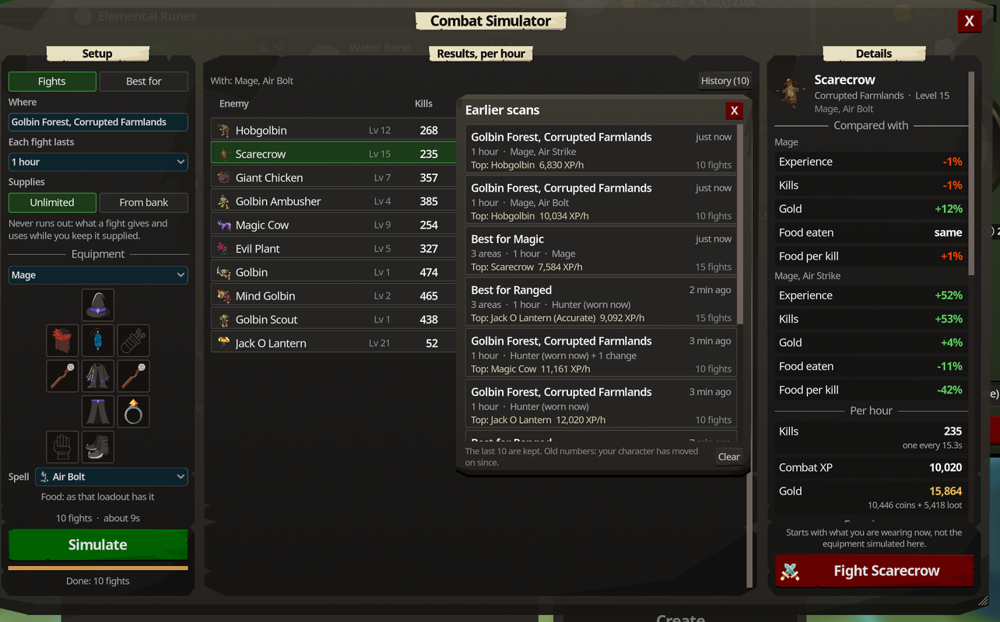
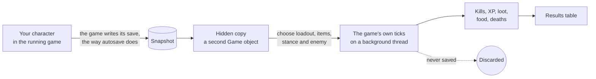

<h1 align="center"></h1>

  
  &nbsp;
  

> What does an hour of this fight give me, what does it cost, and will I die?

## What it does

| | |
| --- | --- |
| **Simulate** | One area (every enemy in it), several, a dungeon, or everything you have unlocked, for 15 minutes to 12 hours of game time per fight. |
| **Results, per hour** | Kills, combat XP, gold, food eaten, deaths, and the lowest your hitpoints got. Click a column to sort. |
| **Details** | XP per skill, loot item by item, what was used (food, ammo, runes, prayer points), damage taken, time of the first death. |
| **Equipment** | Fight with one of your saved loadouts, click any slot to try another item, and choose the spell when the weapon casts one. |
| **Best for** | Pick the skill you want to train and the areas to look in; every fight is tried in each attack stance of your weapon and ranked. |
| **History** | The last ten scans are kept, also after the game was closed: look at one again without simulating anything. |
| **Fight** | The red button under the details starts the selected fight in the game. |

A round button on the right edge of the screen opens the window. It can be dragged from any empty spot and
resized from its bottom right corner.

## Try other equipment

Click a slot to open every item of the game that fits it, with a search box and an "only items I own"
switch. A changed slot gets a gold frame; the same fight simulated with other equipment is compared in the
details.

  
  &nbsp;
  

## Choose where

"Where" opens the list of everything you have unlocked. Tick one area, several, a whole category by its
heading, or nothing at all for everything. Both questions the window answers ("what do these fights give"
and "where should I train") use the areas you tick, and each remembers its own choice.

## Spells

When the weapon of the setup casts spells, a "Spell" box appears under the equipment with the spells that
weapon can cast. Simulate the same fights with two spells and the details compare them, the same way they
compare equipment. With unlimited supplies the copy is handed the runes, so a spell you cannot pay for
right now can still be tried.

## Find where to train

"Best for" answers a different question: not "what does this area give" but "where should I go". Choose a
skill and where to look, and every fight is run once per attack stance of your weapon. Each line shows the
stance that trains the skill best. A weapon with a single stance is simply run once.

## Earlier scans

A scan of everything takes a while, so every one is kept: the last ten for each character, in the mod's own
folder. "History" lists them with what was asked and what came out on top; a click shows that scan again,
table and details, without simulating anything. While nothing has been simulated yet, the newest three are
offered right in the empty table.

The numbers of an earlier scan are from then: your levels and equipment may have changed since. The window
says so while one is on show, and "Back to now" leaves it.

## How it works

It does **not** re-create the game's combat formulas. It runs the game's own combat on a copy of your
character.

- Every fight starts from a **fresh copy** of the same snapshot, so one result cannot leak into the next.
- An hour of fighting takes about a quarter of a second; loading a copy takes about one second. Up to four
  fights run side by side (half of your processor is left to the game you are playing), so thirty-eight
  fights of an hour each are done in about half a minute.
- A copy is let go completely when its fight is over, so a long scan does not fill the memory.
- Because it is the game's combat, everything the game does is in the numbers: your bonuses, prayers,
  potions, auto eat, special attacks, the enemy's passives.

## Good to know

- **Unlimited supplies** hand food, ammo, runes and prayer points back as they are used: the rates of a
  fight that is kept supplied. **From bank** uses what you have and ends the fight when something runs out.
- Fights are random: two runs of the same fight differ by a few percent. Longer fights are steadier.
- An item whose requirements you do not meet cannot be equipped in the copy either; the result says so.
- Farming and Ranching are paused in the copy, so their items do not show up as supplies of the fight.
- The Fight button starts the fight with what you are wearing, not with the equipment you simulated. When
  the result was simulated with what you are wearing, it also selects the stance and the spell of that result.
- `"Workers"` in `mods\CombatSim\settings.json` sets how many fights run side by side (0 lets the mod
  choose). Lower it if the game stutters during a scan.

## Install

1. Install the [Melvor Mod Loader](https://www.nexusmods.com/melvoridle2/mods/2).
2. Extract the mod's zip into the game folder, so the file ends up as `mods\CombatSim\CombatSim.dll`.

To remove it, delete `mods\CombatSim`. Your save is never changed.
