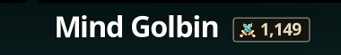

<h1 align="center"></h1>

  
  &nbsp;
  

> How many times have I cleared this dungeon?

A small tag next to each dungeon's name, with the number of times you have completed it.

The tag looks like the one of [Kills in Combat](../KillsInCombat):

## Where it is

Open the combat areas menu, the one you choose an area or a dungeon from.

- **On every dungeon in the list**: the tag sits right after the dungeon's name.
- **On the panel of the dungeon you selected**: the same tag after the name at the top.

Ordinary combat areas get no tag: an area is not something you complete. A dungeon you have never finished
shows `0`. Put the pointer on a tag for the sentence: "Hobgolbin Camp: completed 14 times", or "not
completed yet".

## What the number is

The game's own statistic for that dungeon. So:

- it counts every completion since the character was made, not since you installed the mod;
- runs finished while the game was closed are in it as soon as offline progress has been added;
- a run you left half way is not a completion;
- it is per character.

## Why you might want it

- Tasks and goals that ask for a number of completions.
- Seeing at a glance which dungeons you have never done.
- With the [Combat Simulator](../CombatSim), which gives dungeon runs per hour, you can tell how long a
  number of completions will take.

## Good to know

- The mod has no settings and writes no files.
- It reads one number per dungeon and draws one tag. It cannot affect a run.
- The menu reuses its buttons as you scroll and switch categories; the tags follow.

## When something is off

| You see | What it means |
| --- | --- |
| No tags | They are added the first time the combat areas menu is open. If they never come, look for `[DungeonCompletions] Stopped` in `MelvorModLoader.log`: a game update changed the menu. |
| A tag on something that is not a dungeon | Report it with a screenshot: the menu reused a button in a way the mod did not expect. |

## Install

1. Install the [Melvor Mod Loader](https://www.nexusmods.com/melvoridle2/mods/2) (0.1.3 or newer).
2. Open the game folder: Steam > right-click Melvor Idle 2 > Manage > Browse local files.
3. Extract the mod's zip there, so the file ends up as `mods\DungeonCompletions\DungeonCompletions.dll`.
4. Start the game. `MelvorModLoader.log` in the game folder has a line `Mod loaded: DungeonCompletions`.

To update, extract the new zip over the old one. To remove the mod, delete `mods\DungeonCompletions`.
Your save is never changed.
