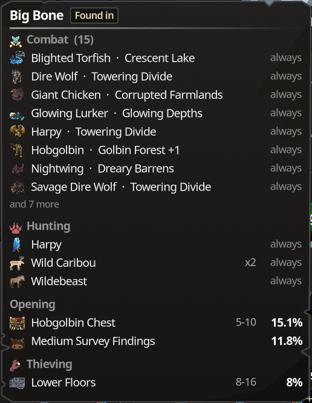
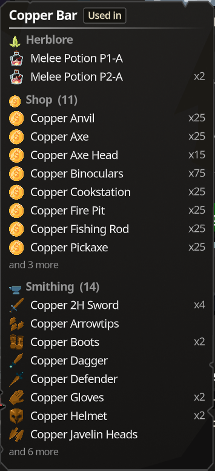
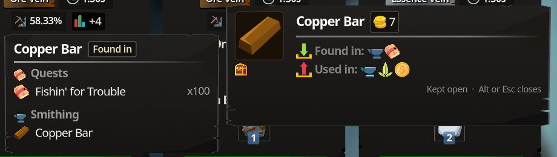
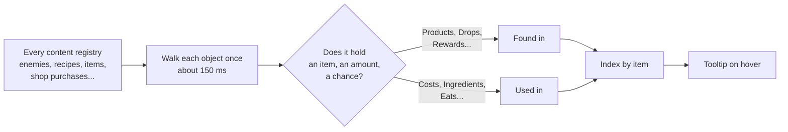

<h1 align="center"></h1>

  
  &nbsp;
  

> Where does this drop, and what is it for?

The game's item panel says "Found in" and "Used in" with a few skill icons. Hover either row and this
lists what is behind them: in the bank, and on any item's tooltip anywhere in the game once you press Alt
to keep it open.

  
  &nbsp;
  

## Anywhere in the game: Alt

The game shows the same small tooltip for an item wherever the pointer is on one: a recipe's materials, a
shop, loot, equipment. It follows the pointer, so its "Found in" and "Used in" rows cannot be reached.

Press **Alt** while that tooltip is up and it stays where it is. Move onto its two rows, and they work like
the ones in the bank. Alt again, Esc, or a click somewhere else lets it go; Alt on another item moves it
there.

So while you look at a recipe: point at the material you are short of, press Alt, and see where it comes
from.

## What it shows

| Row | You see |
| --- | --- |
| **Found in** | Which enemy drops the item and where that enemy lives; which thieving target, hunting animal, chest, recipe, quest or shop purchase gives it; how many, and how likely. |
| **Used in** | Every recipe, upgrade, shop purchase or animal that uses it, and how many it takes. |

Sources are grouped (Combat, Hunting, Opening, Thieving, the skill of a recipe...) with the likeliest on
top. A long group is cut short so the others stay in sight.

## How it works

The game keeps this knowledge spread over its content: an enemy's drop tables, a recipe's products and
ingredients, a thieving target's loot, what a chest holds. Rather than know each of those classes by name,
the mod walks every content registry once when a character is opened.

- Chances are worked out from the game's own drop tables: the table's chance times the item's weight in it.
- Because nothing is hard-coded, items and enemies a game update adds show up by themselves.

## Good to know

- A few relations are left out on purpose, because they neither give nor take the item: quest steps and
  Mastery Guild tasks that ask for it, and the pieces of an equipment set.
- The chances are the base ones from the game's data; bonuses to drop chance are not applied.
- The tooltip that Alt keeps open is a second copy of the game's own item panel, so it looks and reads
  exactly like the original. If a game update changes that panel, only this part switches itself off, and
  says so in the log.

## Install

1. Install the [Melvor Mod Loader](https://www.nexusmods.com/melvoridle2/mods/2).
2. Extract the mod's zip into the game folder, so the file ends up as `mods\ItemSources\ItemSources.dll`.

To remove it, delete `mods\ItemSources`. Your save is never changed.
