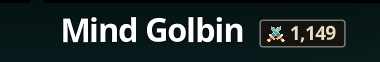

<h1 align="center"></h1>

  
  &nbsp;
  

> How many of these have I killed?

A small tag next to the name of the enemy you are fighting, with the number of times you have killed it.
That is the whole mod.

## Where it is

On the combat screen, right after the enemy's name. Put the pointer on the tag for the sentence:
"Hobgolbin: killed 212 times".

It follows the fight: change enemy and the number changes with it. In a dungeon it shows the count of the
enemy of the moment.

## What the number is

The game's own statistic for that enemy, the same one its statistics and completion pages count with. So:

- it counts every kill of that enemy since the character was made, not since you installed the mod;
- kills made while the game was closed are in it as soon as offline progress has been added;
- it is per character.

The tag is refreshed four times a second, which is to say: right after the kill.

## Why you might want it

- Tasks and goals that ask for a number of kills.
- Deciding whether a rare drop is overdue: with the chance from [Item Sources](../ItemSources) and the
  count from here you know how unlucky you are.
- Curiosity.

## Good to know

- The mod has no settings and writes no files.
- It reads one number and draws one tag. It cannot affect the fight.

## When something is off

| You see | What it means |
| --- | --- |
| No tag | It is added the first time the combat screen is open with an enemy on it. If it never comes, look for `[KillsInCombat] Stopped` in `MelvorModLoader.log`: a game update changed the combat screen. |
| The tag sits over the name | The game's layout changed. Report it with a screenshot. |

## Install

1. Install the [Melvor Mod Loader](https://www.nexusmods.com/melvoridle2/mods/2) (0.1.3 or newer).
2. Open the game folder: Steam > right-click Melvor Idle 2 > Manage > Browse local files.
3. Extract the mod's zip there, so the file ends up as `mods\KillsInCombat\KillsInCombat.dll`.
4. Start the game. `MelvorModLoader.log` in the game folder has a line `Mod loaded: KillsInCombat`.

To update, extract the new zip over the old one. To remove the mod, delete `mods\KillsInCombat`.
Your save is never changed.
