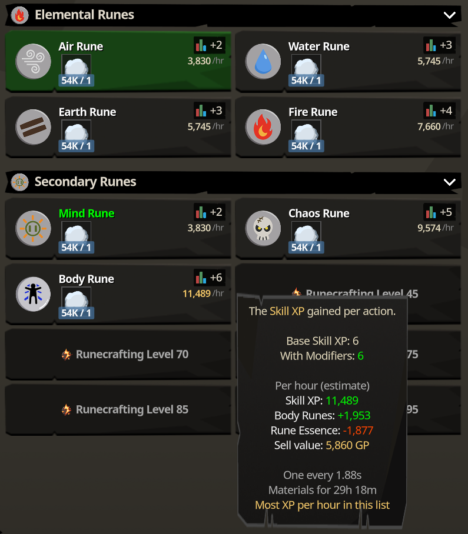
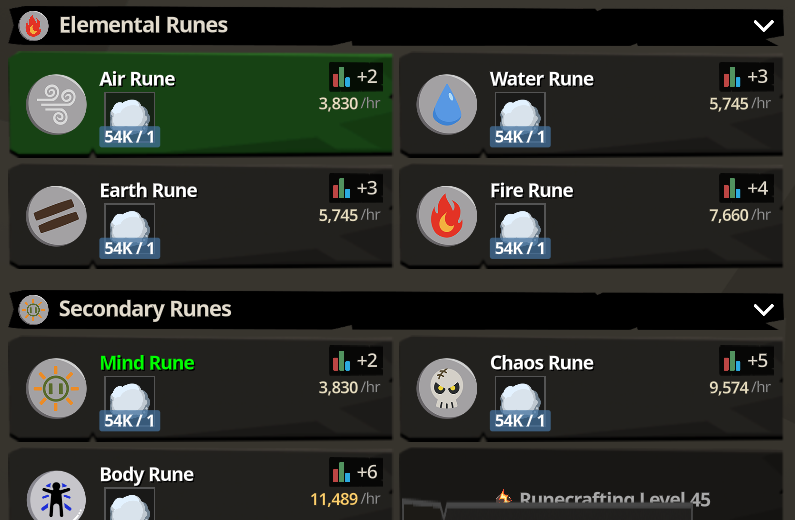

<h1 align="center"></h1>

  
  &nbsp;
  
  &nbsp;
  

> Which recipe gives more XP per hour: the one that takes 60 seconds for 10 XP, or the one that takes 20 for 3?

A recipe shows the XP of one action and, somewhere else, how long the action takes. Recipe Rates does the
division for you, for every recipe of the list at once, and adds the rest of the hour: what you make, what
you use, what it sells for and how long your materials last.

## Contents

- [In the recipe list](#in-the-recipe-list)
- [In the XP tooltip](#in-the-xp-tooltip)
- [What is counted](#what-is-counted)
- [Questions it answers](#questions-it-answers)
- [Good to know](#good-to-know)
- [When something is off](#when-something-is-off)

## In the recipe list

Open Smithing, Crafting, Fletching, Runecrafting, Beastcrafting, Cooking, Firemaking or Herblore. Under the
small XP tag of every recipe is a second number: **XP per hour**. The one in **gold** is the best of the
list you are looking at.

Where a recipe has a long row of ingredients and little room is left, the number is written shorter rather
than over an icon: `5,760 /hr`, then `5.8K /hr`, then `5.8K`.

Nothing has to be started: the numbers are there for recipes you have never made, as long as the game shows
them.

## In the XP tooltip

Put the pointer on a recipe's XP tag. Under the game's own lines is a block that begins with
"Per hour (estimate)":

| Line | What it is |
| --- | --- |
| **Skill XP** | The same number as in the list. |
| A line per product, green, with `+` | How many you make in an hour, doubling included. |
| A line per ingredient, red, with `-` | How many an hour uses, preservation included. Coins and other costs are listed the same way. |
| **Sell value** | What an hour's products sell for. It is not profit: the ingredients are not taken off. |
| **One every 12.5s** | How long one result takes on average. A success chance below 100% is named here. |
| **Materials for 2h 15m** | How long what is in your bank lasts at that pace. "Not enough materials", in red, when you cannot start one. |
| **Most XP per hour in this list** | Only on the best recipe. |

## What is counted

The numbers start from the game's own values for the recipe, which already contain every bonus you have:
equipment, potions, mastery, upgrades. Chances are counted as their long-run average.

| Skill | One result takes |
| --- | --- |
| Smithing, Crafting, Fletching, Runecrafting, Beastcrafting | steps × interval, less the chance to skip a step |
| Herblore | the bottling interval, plus a share of preparing, heating and stirring (they happen once per batch of bottles) |
| Cooking | the interval; a failed attempt takes the time and the ingredients, but gives nothing |
| Firemaking | the interval |

Doubling chance is added to the products. Preservation chance is taken off the ingredients.

## Questions it answers

- **What do I train on?** The gold number. Sort of: check its ingredients too, a recipe you cannot feed is
  not the best one.
- **How many bars will this plan eat?** The red lines of the tooltip, per hour.
- **Can I leave this running tonight?** "Materials for ..." says when it stops.
- **Is the faster recipe really better?** Compare the two numbers: that is exactly the question the mod
  was made for.

## Good to know

- It is an estimate, not a promise. Chances average out over many actions, not over ten.
- Cooking assumes a failed attempt gives neither XP nor food.
- "Materials for" counts what is in the bank now, and is shown in whole minutes so the tooltip does not
  flicker while you craft.
- Only skill XP is shown; mastery XP is not.
- The mod has no settings and writes no files.

## When something is off

| You see | What it means |
| --- | --- |
| No number under a recipe | The game does not show that recipe's XP tag (a locked recipe), or the skill is not one of the eight. |
| The list has numbers, the tooltip has no "Per hour" block | A game update changed the tooltip. The log says "the hourly breakdown is left out"; the list keeps working. |
| No numbers anywhere | Look for a line starting with `[RecipeRates] Stopped` in `MelvorModLoader.log`: the mod switched itself off after a game update. |

## Install

Get the zip from <a href="https://github.com/Springs-Tea/melvor-idle-2-qol-mods/releases">Releases</a>, or from <a href="https://www.nexusmods.com/melvoridle2/mods/19">the mod's page on Nexus Mods</a> if you prefer.

1. Install the [Melvor Mod Loader](https://www.nexusmods.com/melvoridle2/mods/2) (0.1.3 or newer).
2. Open the game folder: Steam > right-click Melvor Idle 2 > Manage > Browse local files.
3. Extract the mod's zip there, so the file ends up as `mods\RecipeRates\RecipeRates.dll`.
4. Start the game. `MelvorModLoader.log` in the game folder has a line `Mod loaded: RecipeRates`.

To update, extract the new zip over the old one. To remove the mod, delete `mods\RecipeRates`.
Your save is never changed.
